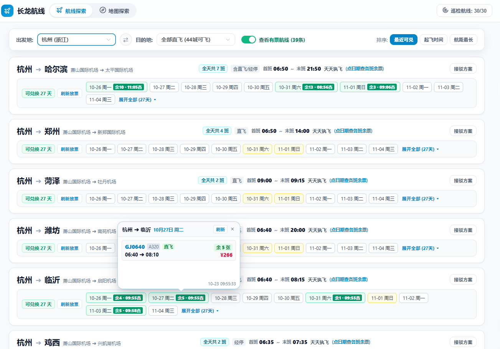
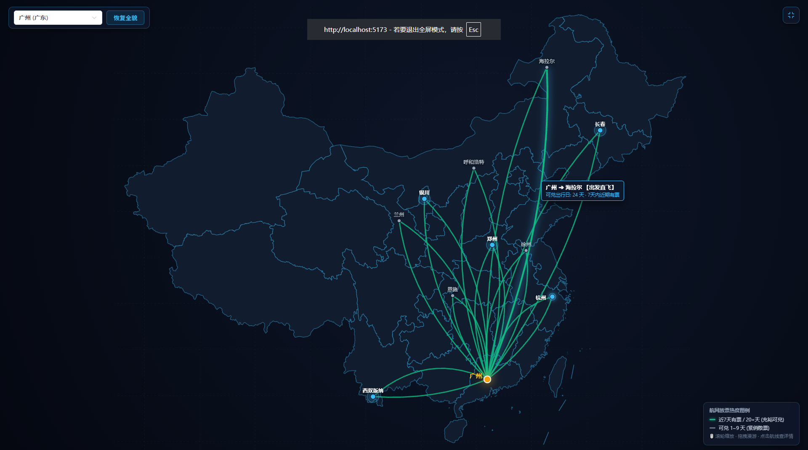

# 长龙航线 · 智能大盘与航网规划助手

[](https://github.com/eureka-wu/clairline/releases/tag/v2.0.0)
[](https://vuejs.org/)
[](https://www.python.org/)
[](https://github.com/eureka-wu/clairline)
[](LICENSE)

> 一款专为长龙航空旅客与常旅客打造的**纯本地、高颜值、现代化全景航网探索与智能兑换决策平台**。  
> 实时全景可视化中国航线网、近 60 天长龙官方放票动态日历、高铁周边延伸接驳漫游、余票持久化与自动化后台巡检。  
> **官方开源仓库**：[https://github.com/eureka-wu/clairline](https://github.com/eureka-wu/clairline)  
> **最新 Release 发布页**：[https://github.com/eureka-wu/clairline/releases/tag/v2.0.0](https://github.com/eureka-wu/clairline/releases/tag/v2.0.0)

---

## 🎬 30 秒核心功能实机演示

> 💡 **嫌看长文太累？** 30 秒带你沉浸式体验全景航网漫游、毫秒级余票微气泡、重点航线监控与后台自动化普查：

<div align="center">
  <video src="https://github.com/eureka-wu/clairline/releases/download/v2.0.0/LoongAirHelper_Promo.mp4" controls="controls" width="100%" style="max-width: 720px; border-radius: 14px; box-shadow: 0 10px 30px rgba(0,0,0,0.3);"></video>
  <p><sub>（若浏览器未加载原生播放器，可点击下方链接直接下载/观看 1080P 高清版）</sub></p>
</div>

| 时间戳 | 对应镜头 | 核心功能亮点 |
| :---: | :--- | :--- |
| **00:00** | 🗺️ **航网大屏** | 490 条全国直飞拓扑，绿线代表近期可兑充裕，滚轮丝滑缩放漫游 |
| **00:05** | ✈️ **列表大盘** | 60 天放票日历，点击绿色胶囊就地弹出班次余票微气泡（首末班时刻/余票数） |
| **00:11** | 🎯 **重点监控** | 常用航线一键锁定，自定义巡检周期与专属度假备注 |
| **00:16** | 📡 **全网普查** | 一键启动发光动态雷达，转入后台时右下角微雷达常驻监控 |
| **00:22** | 🛡️ **本地安全** | 纯本地运行无云端，绿色单文件解压即用，绝不上传个人敏感凭据 |

👉 **[下载 1080P 超清演示视频 (LoongAirHelper_Promo.mp4)](https://github.com/eureka-wu/clairline/releases/download/v2.0.0/LoongAirHelper_Promo.mp4)**

---

## 📸 2K 超清界面预览 (v2.0.0 官方实机界面)

### ✈️ 航线探索（列表大盘 · 居中 1280px · 2.7K 视网膜高清）
吸顶智能筛选栏 + 航线卡片：展示首末班时刻跨度、60 天放票日期胶囊，已查验日期以绿色微标回显余票（如 `余16 · 12:59查`），点击日期就地弹出班次明细气泡；右下角常驻微雷达进度监控卡片。



### 🗺️ 航网地图探索（全屏沉浸大屏 · 3.2K 超清）
以指定城市（如杭州、广州）为出发地的全屏暗黑航网：绿线为近 7 天有票 / 20+ 天充裕可兑，灰线为紧俏散票；悬停航线即显示可兑出行日天数，支持滚轮缩放与平移漫游，带右侧航线抽屉弹窗自适应。



---

## ⚡ 极速上手：下载 Release 绿色客户端 (普通用户强烈推荐)

> **零环境依赖！无需安装 Python、无需配置 Node.js/npm，双击即开即用！**

### 📥 1. 下载预编译单文件程序

前往 GitHub Releases 官方发布页，下载最新版本的 Windows 单文件客户端：

👉 **[下载最新 v2.0.0 发布版 (LoongAirHelper-v2.0.0.exe)](https://github.com/eureka-wu/clairline/releases/tag/v2.0.0)**

- **支持系统**：**Windows 10 / Windows 11 (64位)**；
- **渲染内核**：依赖系统内置的 **Microsoft Edge WebView2**（Win 11 与绝大多数 Win 10 已出厂自带，无需额外安装）；
- **完整内置**：单文件已完整打包 Python 3 运行时、SQLite 数据库引擎、自动化抓包引擎与前端所有构建产物；
- **绿色便携**：无需任何安装程序，不写入系统注册表，查票流水缓存与个人配置均自动保存在同级目录下，随删即卸。

### 🚀 2. 使用步骤
1. 下载 `LoongAirHelper-v2.0.0.exe` 保存至任意本地目录（如桌面或常用软件文件夹）；
2. **双击直接运行**，客户端将自动启动本地服务并拉起现代桌面窗口；
3. 点击界面右上角「**同步长龙登录**」，在电脑端微信打开长龙航空小程序，系统将自动嗅探捕获乘云会员凭证并实时回显姓名与授权卡片；
4. 自由探索全国 490 条直飞航线大盘与 60 天放票日历，尽享一站式快速兑换规划！

---

## 💻 开发者指南：源码拉取与本地开发

如果你希望进行二次开发、定制功能、调优 UI 或贡献代码，可以按以下方式在本地运行：

### 方式一：极速协同开发模式 (推荐 · 毫秒级热更)

> **单终端并发托管 Python 后端 (端口 `3000`) 与 Vite 前端开发服务器 (端口 `8173`)**

```bash
# 1. 克隆代码仓库
git clone https://github.com/eureka-wu/clairline.git
cd clairline

# 2. 安装前端依赖
cd frontend
npm install
cd ..

# 3. 安装后端基础依赖
python -m pip install -r requirements.txt
# (若未安装 requests / pywebview，执行: pip install requests bottle pywebview)

# 4. 一键启动前后端协同热重载 (两种方式任选其一)
# 方式 A: 双击根目录下的 dev.bat
# 方式 B: 在终端中执行:
python dev_runner.py
```
- 前端修改代码支持 Vite 毫秒级 HMR 局部热刷新；
- 后端 Python 业务逻辑与 API 修改支持自动重启热重载；
- 在浏览器中打开 `http://localhost:8173` 即可实时联调。

---

### 方式二：纯 Python 本地服务 (免 Node.js · 浏览器访问)

> **适合轻量本地跑服务，前端生产产物已编译固化分发！**

```bash
# 1. 克隆开源仓库
git clone https://github.com/eureka-wu/clairline.git
cd clairline

# 2. 直接启动后端一体化托管服务
python backend/server.py
```
终端将提示服务在 `http://127.0.0.1:3000` 监听，打开浏览器访问即可享受完整功能。

---

### 方式三：开发者自行封包 Exe 客户端

若你对前端界面或后端接口进行了二次开发，并希望打包成单文件绿色 Exe：

```bash
# 1. 编译生成最新前端静态产物
cd frontend
npm run build
cd ..

# 2. 安装桌面封装与打包依赖
python -m pip install pywebview PyInstaller

# 3. 运行一键打包脚本
python build_exe.py
```
打包成功后，单文件客户端将生成在：
`dist/LoongAirHelper-v2.0.0.exe`（并同步复制 `dist/LoongAirHelper.exe`）。

---

## 🌟 核心特性与架构亮点

- ⚡ **全自动无感嗅探凭据 (彻底告别 Fiddler 与 .bat)**：
  - 网页右上角点击「同步长龙登录」，在电脑微信打开长龙航空小程序，嗅探器自动开启 Windows 代理并精准截获认证凭证；
  - **毫秒级智能识别**：自动向长龙接口拉取真实会员姓名（如实名乘云会员）、畅飞卡授权 ID，原子化落库，抓取完成瞬间直接呈现在界面上；
  - 捕获完成即自动平稳关闭系统代理恢复直连，用后即焚、零手动配置。
- ✈️ **全网直飞航线大盘 (1280px 居中 · 吸顶筛选)**：
  - 收录全国 71 座通航城市、397 条长龙直飞航线与 490 个定期航班基础拓扑；
  - **筛选栏 Sticky 粘性吸顶**：长列表滚动时出发地/目的地/排序工具栏紧贴顶部，随时随地切换筛选；
- 📋 **全新表格化重点监控配置 (不设上限 · 备注自定义)**：
  - 重点监控全面重构为**一行一行的表格列表**，摒弃拥挤标签堆叠；
  - 支持每条航线**自定义配置名称与备注**（如滑雪胜地、回老家专线），随录随存；
  - 支持**巡检批次时间自由调节**（如每 25 分钟巡检一次），保存即生效；
  - 默认 0 条纯净初始状态，解除上限，支持随心添加任意条数。
- 📊 **两级专属进度条与微雷达卡片**：
  - **隔离式双进度条**：重点监控 Tab 仅展示重点巡检进度，全网普查 Tab 仅展示全量拓扑普查进度，彻底告别串味；
  - **右下角悬浮微雷达**：转入后台巡检后，右下角常驻半透明微雷达监控小部件，支持一键无缝放大全屏雷达大图。
- 🗺️ **原生轻量矢量 SVG 动态航网大屏**：
  - **两档纯净色阶**：绿线（充裕）vs 灰线（紧俏），单一显色不重叠，自带近期可兑航线流动光效粒子动画；
  - **一键全屏沉浸大屏**：支持城市聚焦筛选下拉搜索，点击航线右侧抽屉弹窗自适应滑出，带一键“恢复全貌”。
- ⏱️ **SQLite 在库持久化与智能保活微气泡**：
  - 本地 SQLite WAL 高性能模式存储，任何日期点击查验后，各班次剩余张数、时刻、机型永久落库到本地 `seat_queries` 表；
  - 再次点击 **0 毫秒直接从数据库弹窗**，零网络请求、零风控；气泡内部滚动流畅放行，外部滚动平稳关闭。

---

## 🛡️ 纯本地开源理念 (100% Local & Privacy-First)

本项目遵循**纯本地单机运行**与**隐私绝对隔离**原则：
1. **零第三方云端上报**：所有航网数据、放票日历、查验流水、巡检配置以及个人凭据 **100% 保存在用户本机**，无任何外部遥测或第三方数据回传；
2. **端到端完全开源可审计**：前后端所有源代码公开透明在 [GitHub 仓库](https://github.com/eureka-wu/clairline)，绝无后门，安全可靠；
3. **敏感凭据物理隔离**：个人账号 Token、查票记录与 SQLite 数据库已配置严格的 Git 忽略策略，绝不随代码提交；新用户冷启动自动植入官方直飞航线种子，开箱立用；
4. **系统代理安全闭环**：嗅探仅针对长龙官方域名，结束后全自动关闭恢复 Windows 系统代理，绝不干扰外部网络与开发环境。

---

## 📁 目录结构

```text
clairline/
├── app_desktop.py            # 基于 Edge WebView2 的轻量桌面客户端入口
├── build_exe.py              # PyInstaller 一键封包绿色 Exe 脚本
├── dev_runner.py             # 开发者单终端前后端并发与自动热重载调度器
├── dev.bat                   # Windows 极速一键协同开发启动脚本
├── backend/                  # Python 后端服务与 SQLite3 数据库引擎
│   ├── data/                 # 本地数据存储目录 (除种子外已严格配置 .gitignore)
│   │   ├── routes_seed.json  # 全网 490 个航班直飞航网种子 (开箱免配置初始化)
│   │   ├── changlong.db      # 本地私有 SQLite 数据库 (自动建表，不上传)
│   │   └── credentials.json  # 本地抓取凭据 (不上传)
│   ├── db.py                 # SQLite3 WAL 模式连接池、CRUD 与种子注入层
│   ├── loongair_client.py    # 长龙官方核心接口客户端 (身份与畅飞卡授权)
│   ├── capture_addon.py      # mitmproxy 自动化凭证嗅探核心
│   ├── capture_manager.py    # 嗅探生命周期管理与守护线程
│   ├── proxy_util.py         # 纯原生 Windows 系统代理安全重置工具
│   ├── auto_patrol.py        # 自动化巡检守护进程 (重点航线慢速轮巡 / 全网定时普查)
│   ├── seccard_client.py     # 官方查票与日历接口穿透客户端
│   ├── scheduler.py          # 定时调度核心模块
│   └── server.py             # 前后端一体化 HTTP 托管服务 (端口 3000)
├── frontend/                 # Vue 3 + Vite 单页应用工程
│   ├── dist/                 # 固化生产编译产物 (供 Python 直接高并发分发)
│   ├── src/
│   │   ├── api/              # API 接口通信模块 (auth.js, flights.js, patrol.js)
│   │   ├── assets/           # 统一设计系统 main.css 与最新高清实机截图
│   │   │   ├── table-view.png # 航线探索大盘列表截图
│   │   │   └── map-view.png   # 全屏暗黑航网地图截图
│   │   ├── components/       # 业务组件
│   │   │   ├── AppHeader.vue         # 顶部导航、GitHub 链接、身份胶囊与配置入口
│   │   │   ├── AuthModal.vue         # 纯 SVG 矢量引导、无 Emoji 认证同步弹窗
│   │   │   ├── RouteFilterBar.vue    # 出发/目的地级联、互换、排序 (Sticky 吸顶)
│   │   │   ├── RouteCard.vue         # 航线卡片 (时刻跨度、日期胶囊、纯粹接驳按钮)
│   │   │   ├── SeatPopover.vue       # 就地轻量微气泡 (抗塌缩平稳蒙层、智能悬停保活)
│   │   │   ├── RouteDetailDrawer.vue # 60天日期流、落地周边游与高铁接驳
│   │   │   ├── PatrolModal.vue       # 表格化重点监控配置、轮巡间隔调节、隔离进度条
│   │   │   ├── FullPatrolProgress.vue# 全网普查动态雷达仪表盘大图
│   │   │   └── FlightMap.vue         # 原生矢量 SVG 航网漫游、两档纯净色阶与一键全屏
│   │   ├── data/             # 元数据与纯矢量 SVG 图标集 (icons.js, city-meta.js)
│   │   ├── App.vue           # 根组件 (含右下角常驻微雷达卡片)
│   │   └── main.js           # Vue 入口脚本
│   ├── index.html            # Vite 现代 HTML 入口
│   ├── package.json          # 前端依赖配置
│   └── vite.config.js        # Vite 构建与开发代理配置
├── .gitignore                # 严格的隐私凭据、本地数据库与构建忽略规则
└── README.md                 # 项目完整文档
```

---

## 📄 开源协议与免责声明 (License & Disclaimer)

### ⚖️ 开源协议 (License)
本项目采用 [MIT 许可证](LICENSE) 开源。你可以在遵守 MIT 许可条款的前提下自由使用、修改、分发本项目的源代码与衍生作品。

### ⚠️ 免责与合规声明 (Disclaimer)
在使用本项目（包括但不限于源代码、二进制可执行程序及衍生脚本）之前，请务必仔细阅读并理解以下条款。任何使用本项目的行为均将被视为对本声明全部内容的无条件认可与接受：

1. **非官方与无关联声明**：本项目由开发者独立开发与维护，**与浙江长龙航空有限公司（LoongAir）无任何官方关联、雇佣关系或商业合作**。“长龙航空”、“乘云会员”、“畅飞卡”等所有相关商标、标识及知识产权均依法归属于长龙航空官方所有；
2. **仅限学习与研究用途**：本项目仅供个人技术研究、前端现代化工程架构探索及自用行程规划参考，**严禁将本项目及其衍生版本用于任何商业牟利、付费代刷代查、黑产变现或其他营利性商业行为**；
3. **数据权威性与时效性**：项目中展示的航网拓扑、时刻跨度、放票日历与余票动态均来源于本地离线缓存及网络响应，不构成任何最终出行或购票承诺。**所有航班时刻、兑换规则及最终可用席位 100% 以长龙航空官方微信小程序、官方 APP 及官网最新发布数据为准**；
4. **有限责任与风险自担**：
   - 本软件按“现状”（AS-IS）提供，作者与贡献者不提供任何明示或暗示的可用性或稳定性担保；
   - 使用者需自行规范请求频次与使用行为，因使用者高频扫描或不当操作引发的任何账号风控（如接口频控限制、验证码校验等）或连带损失，**项目作者及贡献者概不承担任何法律责任**；
5. **网络安全与合规底线**：严禁利用本项目对民航系统或长龙航空服务器发起任何形式的恶意攻击、高并发破坏或漏洞利用，请自觉遵守《中华人民共和国网络安全法》及相关法律法规。
